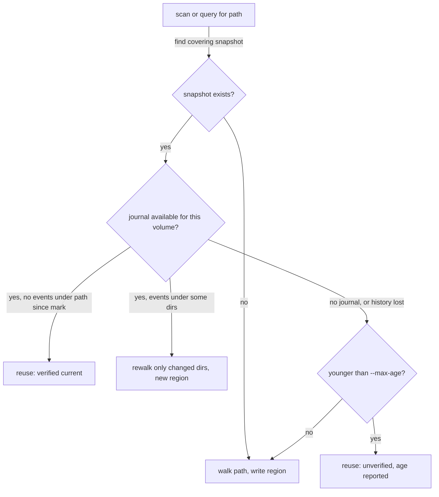

# RFC 0001: Lazy snapshot storage, reuse of recent scans, honest freshness

Status: Draft

## Summary

Split the snapshot into a small directory spine that is always loaded and file records kept in
independently compressed blocks that are read only when a query needs them. Track when each part
of the tree was last read, so that dredge reuses recent work instead of rescanning it, scanning a
nested folder updates the parent snapshot instead of duplicating it, and every answer says exactly
how old it is and whether that age has been checked. Changes after a scan are found through the
OS change journal where one exists, and a full rescan is done (and said) where none does.

## Motivation

Measured on a 10-core Mac, APFS, a developer directory of 7.8M nodes (7,016,936 files, 788,259
directories), `docs/BENCHMARKS.md`:

| Operation | Today | Where the cost goes |
| :- | -: | :- |
| `dredge scan` | 42–80 s, 935 MB peak RSS | Kernel listing (fixed in part by the `getattrlistbulk` backend), then the whole index built in memory and finalized |
| `dredge browse <root> --limit 3` | 0.34 s, 365 MB RSS | Decompresses and loads every column for 7.8M nodes to show 3 rows |
| `dredge snapshots` | 0.00 s, 6.8 MB | Reads only the uncompressed header |
| Scanning a nested folder after its parent | Full walk of the folder again, a second snapshot on disk | Snapshots are per root and never share data |

The memory and the duplicate walks grow with the tree, not with the question being asked. Two
honesty gaps come with this:

1. `age_secs` says when the whole snapshot was taken. After a nested rescan, the parent snapshot
   still answers for its own root with old numbers for the folder that was just rescanned, and
   nothing says so.
2. Nothing tells the user whether an old snapshot is still correct. Ten minutes old and unchanged
   looks the same as ten minutes old and wrong.

## Design

### 1. Storage v2: spine plus file blocks

```
magic     8 B   "DREDGE\0\2"
version   u32   2
hdr_len   u32
header    JSON, uncompressed (as v1, plus the fields below)
spine     zstd frame: directories only, in DFS pre-order
blocks    N zstd frames of file records
footer    block table: offset, compressed length, file range, max allocated size, per block
trailer   footer offset u64, magic
```

**Spine** (about 10% of nodes here: 790k directories). Columns, struct-of-arrays as today:
`parent u32, name_off u32, name_len u16, flags u16, allocated u64, logical u64, mtime u32,
subtree_end u32, files u32, file_start u32, file_count u32, region u16`. That is 50 B per
directory plus the directory names, an estimated 45–60 MB loaded for this tree instead of 365 MB.
`file_start..file_start+file_count` is the directory's own files; because directories are in
pre-order and files are grouped in the same order, a whole subtree's files are the single range
`file_start[i] .. file_start[subtree_end[i]]`.

**File blocks.** File records in directory pre-order, cut into blocks of 65,536 files, each
compressed on its own with its own name arena. Per file: `name_off u32, name_len u16, flags u16,
allocated u64, logical u64, mtime u32` (28 B before compression). The footer keeps each block's
largest `allocated`, so `largest` reads blocks in descending order of that maximum and stops once
the k-th result is larger than the next block's maximum.

**Side tables**, in the spine frame: hard-link groups (as today), a per-snapshot top-1000 files
list (answers the default `largest` with no block read), and a per-extension byte histogram for
the whole root (answers `types` at the root with no block read).

**Reading.** Blocks are read with positioned reads (`FileExt::read_at` / `seek_read`), which are
safe Rust, so `dredge-core` stays `#![forbid(unsafe_code)]` and no `mmap` crate is needed. A
loaded snapshot keeps the spine and a small LRU of decompressed blocks (default 8 blocks).

| Query | v1 reads | v2 reads (expected) |
| :- | :- | :- |
| `browse` | whole index | spine + the blocks holding that directory's own files (usually 1) |
| `detail` | whole index | spine, + 1 block for a file |
| `largest` at a root, `limit` ≤ 1000 | whole index | spine only (top-1000 table) |
| `largest` in a subtree | whole index | blocks overlapping the subtree, pruned by block maximum |
| `types`, `categories` in a subtree | whole index | blocks overlapping the subtree |
| `insights` | whole index | spine (most rules are directory rules), blocks only for file rules |

These are expectations to confirm by benchmark before the RFC is accepted, not measurements.

**Writing without holding every file.** Each `read_dir` already yields one directory's files
together. The scanner appends them as a run to a temporary spill file in the data directory
(compressed, sequential, dredge's own file, deleted afterwards) and keeps only `dir → spill
offset` in memory (16 B per directory). Finalize sorts the spine into pre-order and copies runs
into blocks in that order. Peak memory becomes the spine plus a block buffer per thread, an
estimated 150–200 MB here instead of 935 MB. If the spill file cannot be written (read-only data
directory, full disk), the scan falls back to the in-memory build.

### 2. Regions: when each part was read

A region is a subtree read in one walk. The header carries a region table:
`{ id, root_dir, scanned_at, journal_mark }`. Every spine directory records the region it was
last read in. A full scan has one region. A nested rescan adds one.

### 3. Nested scans update the parent

`dredge scan <path>` where `<path>` lies inside an existing snapshot's root walks only `<path>`
and splices the result into that snapshot: the subtree's spine range and file blocks are
replaced, ancestor totals are adjusted by the difference, and a new region is recorded. One
snapshot per volume root stays on disk instead of one per scanned folder. A scan of a path
outside every snapshot creates a new one, as today. If a later scan covers an existing smaller
snapshot entirely, the smaller one is absorbed and deleted.

### 4. Reuse recent work, and say so



*How a scan decides between reuse, a partial rewalk and a full walk.*

- `dredge scan` reuses by default only when reuse is **verified** by the change journal. With no
  journal it rescans unless `--max-age <dur>` is given, and then says the result is unverified.
  `--force` always walks.
- Queries never scan on their own (unchanged rule: queries never touch the live filesystem). They
  report freshness as below.

### 5. Change journals

| Platform | Source | Notes |
| :- | :- | :- |
| macOS | FSEvents history: store the volume's FSEvents UUID and last event ID at scan time; on the next scan, replay events since that ID for the root | Directory-level events. `MustScanSubDirs`, a changed volume UUID, or dropped history fall back to a full walk of the affected subtree, and the output says why. Needs CoreServices FFI in `crates/dredge-scan/src/platform/` (unsafe allowed there). |
| Windows | NTFS USN journal: store journal ID and next USN | Reading the journal needs a volume handle that I believe requires an elevated process; to verify. Without it: no journal, as on Linux. |
| Linux | None that persists across runs | Full rewalk. Directory mtimes are **not** used to skip subtrees: a file growing in place changes the file's mtime, not its directory's, so skipping would hide real changes. |

A journal only says which directories changed. dredge then lists those directories again; it
never reads file contents and never hydrates cloud placeholders (dataless directories stay
flagged and unentered).

### 6. Lazy, live scanning

- The walker gets a priority lane: the directory the TUI is showing (or an MCP `disk_browse`
  path during a running job) is listed before the rest of the queue.
- Each spine directory keeps a pending-descendants counter. While it is above zero the
  directory's totals are partial.
- Browsing during a scan reads the in-progress spine; partial directories show their running
  total marked `counting…`, matching the TUI design ("You don't have to wait").

## Output change

`schema_version` 3 → 4. Additive fields in the envelope and in `scan`; no field is removed or
renamed. `docs/OUTPUT_SCHEMA.md` diff:

```diff
 "snapshot": { "root": "...", "taken_at": "...", "age_secs": 5231,
+  "path_scanned_at": "2026-11-14T09:02:11Z", "path_age_secs": 42,
+  "oldest_part_age_secs": 5231,
+  "verified_at": "2026-11-14T09:03:00Z" | null,
+  "partial": false }
```

| Field | Meaning |
| :- | :- |
| `path_scanned_at`, `path_age_secs` | When the queried path itself was last read (its region). |
| `oldest_part_age_secs` | Age of the oldest region inside the queried subtree. Differs from `path_age_secs` after a nested rescan. |
| `verified_at` | Last time a change journal confirmed no changes under the path; `null` when never verified (always `null` on Linux). |
| `partial` | `true` while a scan is still running for part of this subtree; affected rows carry the `counting` flag. |

`scan` summary gains `reused` (`"verified"`, `"unverified"` or `null`), `rewalked_dirs`, and
`journal` (`"fsevents"`, `"usn"`, or `null` with a `journal_reason`). Rows gain the flag
`counting`. Snapshot format version 2; v1 files are still readable (loaded whole, as today) and
are upgraded on the next scan of their root.

## Read-only and local impact

- New file: a temporary spill file in the data directory during a scan, deleted at the end
  (and on startup if a crashed scan left one). dredge still writes only its own files.
- Reading FSEvents history or the USN journal reads metadata the OS already keeps. No network,
  no watchers left running, no daemon.
- Splicing rewrites the parent snapshot atomically (temp file, fsync, rename), as today.

## Alternatives

- **mmap the whole snapshot.** Lowest load latency, but needs `unsafe` or a new crate in
  `dredge-core`, and compressed data cannot be mapped directly. Positioned reads of compressed
  blocks give most of the gain safely.
- **An embedded database (SQLite, LMDB, redb).** Range queries and updates for free, but a new
  class of dependency, several times larger on disk than columnar zstd, and slower for the full
  scans `types` and `categories` need.
- **One file per directory.** Easy splicing, but millions of small files is exactly the workload
  that makes scanning slow.
- **Skip unchanged subtrees by directory mtime.** Unsound for in-place file changes (see Linux
  above).
- **A long-running watcher daemon.** Always fresh, but it is a background process that users did
  not ask for, and it breaks the "nothing runs unless you run it" promise.

## Test plan

- Parity: every query on v1 and v2 snapshots of the same fixtures returns identical output
  (apart from the new fields).
- Splice: scan a fixture, change a nested folder, rescan only that folder, compare with a full
  rescan of the root. Totals, rows and hard-link groups must match.
- Freshness: `path_age_secs` and `oldest_part_age_secs` after a splice; `verified_at` stays
  `null` without a journal.
- Journals: FSEvents replay on a temporary directory (macOS CI), with forced history loss falling
  back to a walk; Linux reports `journal: null`.
- Corruption: a truncated block or footer gives `snapshot_corrupt` for queries that need it and
  leaves spine-only queries working.
- Benchmarks recorded in `docs/BENCHMARKS.md` before acceptance: load RSS and latency for
  `browse`, `largest`, `types` on the 7.8M-node tree, and peak scan RSS with the spill path.
